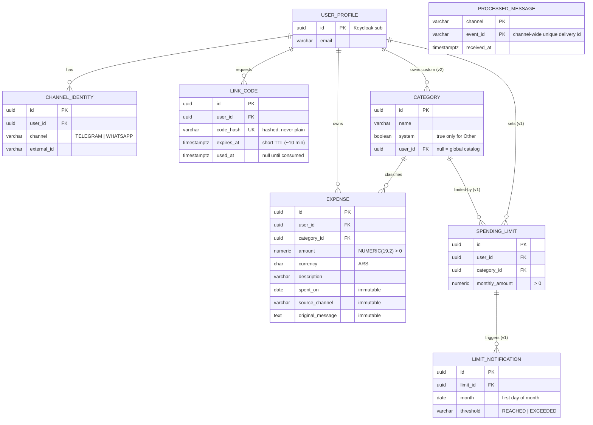

# Entity-relationship diagram

Target data model derived from the issues (#4-#24). `category` already exists (V1); the rest is planned.
Audit columns (`created_at`, `updated_at`) are omitted for readability and belong to persistence only.

## Constraints that matter

| Table | Constraint | Why |
|---|---|---|
| `channel_identity` | `UNIQUE (channel, external_id)` | One Telegram identity belongs to one user (#5) |
| `channel_identity` | `UNIQUE (user_id, channel)` | One account per channel per user |
| `link_code` | `UNIQUE (code_hash)` | Lookup by hash; single use via `used_at` |
| `category` | unique `lower(name)` where `user_id IS NULL` (exists) | No duplicate global names |
| `category` | unique `(user_id, lower(name))` where `user_id IS NOT NULL` | Custom names unique per user (#23) |
| `processed_message` | `PRIMARY KEY (channel, event_id)` | Idempotency enforced by the database (#8) |
| `spending_limit` | `UNIQUE (user_id, category_id)` | One limit per user and category (#20) |
| `limit_notification` | `UNIQUE (limit_id, month, threshold)` | Each threshold notifies once per month (#21) |

## Ownership by module

| Module | Tables |
|---|---|
| `accounts` | `user_profile`, `channel_identity`, `link_code` |
| `expenses` | `expense`, `category` |
| `channels` | `processed_message` |
| `budgets` (v1) | `spending_limit`, `limit_notification` |
| `conversation` | Spring AI chat memory table (managed by the framework) |

## Design notes and open points

1. **`processed_message` is separate from `expense` on purpose.** Messages that produce no expense (clarification requests, unlinked users, invalid LLM output) must also be deduplicated; a unique key on `expense` would not cover them.
   **`event_id` is not the platform's `message_id`.** Telegram documents `message_id` as unique only inside a chat, so `(channel, message_id)` would collide across users. The Telegram adapter fills `event_id` with the `update_id` (unique per bot, documented for ignoring repeated updates); the WhatsApp adapter will use its globally unique message id.2. **Cross-module foreign keys: decided, the database enforces them** (e.g. `expense.user_id -> user_profile.id`). The app will not be split into microservices, so database integrity is worth more than schema decoupling. In code the modules stay decoupled: they reference each other by id and never share JPA entities.
3. **One identity per channel per user: decided.** A user links at most one account per channel (`UNIQUE (user_id, channel)`), so notifications always have a single unambiguous destination.
4. **Pending clarification (#11)** has no table yet. It can live in the chat memory or in a dedicated `pending_clarification` table with `expires_at`. Decide when designing the conversation flow.
5. **Money:** `NUMERIC(19,2)` plus explicit currency; no floating point anywhere.
6. **`system` category** is looked up by its fixed id, never by name.
