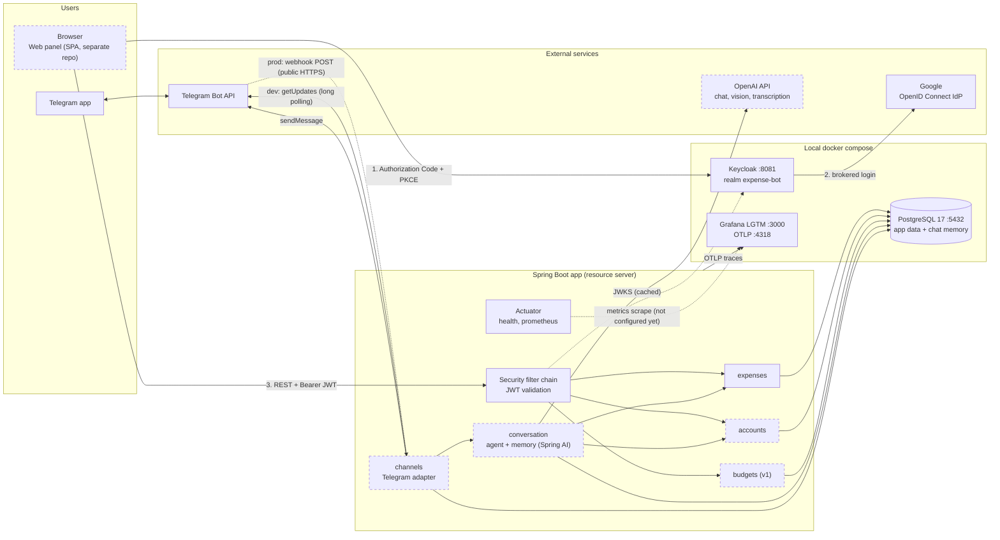

# Infrastructure diagram

Runtime view: what runs where and who talks to whom. Solid boxes exist today (local `compose.yaml` and the Spring Boot app);
dashed boxes are planned. Production hosting is **not decided yet**, so the prod-only parts are shown as intent, not as a design.

## What exists today

| Piece | State |
|---|---|
| Postgres 17, Keycloak 26 (realm imported), Grafana LGTM in `compose.yaml` | Running locally |
| Spring Boot app: security filter chain with JWT validation, `GET /api/categories`, Actuator | Built |
| Flyway migrations (`category` only) | Built |
| Telegram inbound adapter (webhook and long polling, chosen by `telegram.mode`) handing a channel-agnostic `IncomingMessage` to `conversation`, which only logs it for now | Built |
| Telegram replies (`sendMessage`, #7), agent, accounts, budgets, OpenAI calls | Not built |

## Connections and protocols

| From -> To | Protocol | Notes |
|---|---|---|
| SPA -> Keycloak | OIDC Authorization Code + PKCE | Public client, no secret |
| Keycloak -> Google | OIDC (confidential client) | Holds Google client id/secret |
| SPA -> app | HTTPS + `Authorization: Bearer` | Validated locally against Keycloak's public keys |
| app -> Keycloak | HTTPS (JWKS download) | Only to fetch/refresh keys, not per request |
| app -> Telegram | HTTPS, outbound | Polling in dev, `sendMessage` always |
| Telegram -> app | HTTPS, **inbound** | Webhook, prod only; needs a public URL. The app registers it itself on startup (`setWebhook`) |
| app -> OpenAI | HTTPS, outbound | API key from environment |
| app -> Postgres | JDBC | One database, all modules, FKs enforced |
| app -> Grafana LGTM | OTLP over HTTP | Traces; endpoint from `OTLP_ENDPOINT` |

## Entry points

| Entry point | Who uses it | Authentication |
|---|---|---|
| REST API (`/api/**`) | Web panel (SPA, separate repo): link codes, edit expenses, lists and dashboards (#5, #12, #18, #19, #20) | Keycloak JWT |
| Telegram (polling in dev, webhook in prod) | Users chatting with the bot | Bot token (outbound) / `secret_token` (webhook) |
| WhatsApp webhook (v2, #27) | Users chatting on WhatsApp | Signature validation |
| Actuator | Operations (health, metrics) | Not decided |

Both user-facing paths end in the same business modules, only the door differs.

## Design notes and open points

1. **The webhook is outside JWT authentication (resolved).** Telegram does not send a JWT, so `/api/telegram/webhook` has its own `permitAll` rule in `SecurityConfig` and the controller authenticates the call with Telegram's `secret_token` header (constant-time comparison, rejects everything when no secret is configured). Polling in dev is not affected because it is an outbound call.
   **One delivery mode per bot.** Telegram stores either a webhook URL or none, and `getUpdates` does not work while a URL is set. The app therefore calls `deleteWebhook` before polling and `setWebhook` in webhook mode. If registering fails in webhook mode the app still starts and logs the error, so a silent deaf bot is possible if nobody reads the log.
2. **Production hosting is undecided.** Webhook mode needs a public HTTPS endpoint, and Keycloak in `start-dev` mode is not meant for production (it needs its own database and HTTPS). Nothing to decide for the MVP, but it shapes the portfolio demo.
3. **Metrics are exposed but not collected.** `/actuator/prometheus` exists, yet nothing scrapes it (issue #15 depends on this). Whether the LGTM container scrapes the app or metrics go out through OTLP is open.
4. **OpenAI is a hard dependency of the core flow.** If it is down or slow, no expense is registered from chat. The behavior (reply "try again", retry, queue) is a design decision for the conversation flow, see the sequence diagram.
5. **Keycloak and the app use separate storage.** In local dev Keycloak keeps its own data in a volume, not in the app's Postgres. The `issuer` URL must match exactly between where Keycloak is reached and the app's `issuer-uri`.
6. **Single app instance.** Long polling allows only one consumer per bot, so dev runs one instance. Webhook mode removes that limit.
