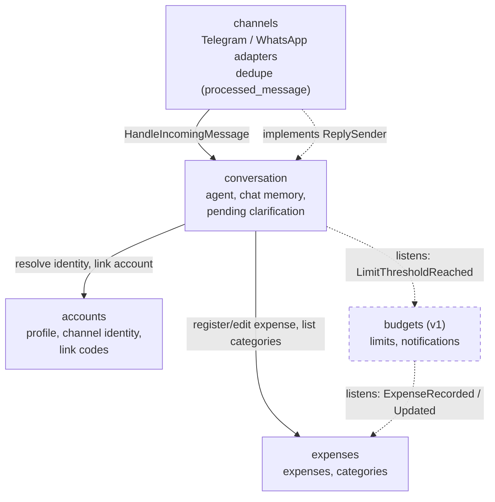
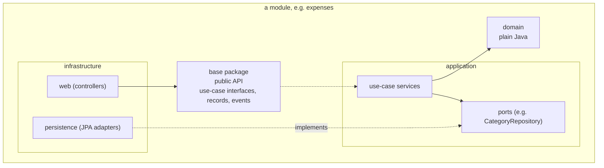

# Module and dependency diagram

How the five modules depend on each other. An arrow `A --> B` means "A uses B's public API" (the module's base package:
use-case interfaces, small records, events). Nobody may touch another module's `domain`, `application` or `infrastructure`.

Legend: solid = direct call to a use-case interface; dotted = event listener or an interface implemented by the other side.

The graph has no cycles: `channels -> conversation -> {accounts, expenses, budgets} ; budgets -> expenses`.
`accounts` and `expenses` depend on nobody.

## Why the arrows go this way

| Decision | Reason |
|---|---|
| `channels` depends on `conversation`, not the reverse | `conversation` declares a `ReplySender` port in its public API; `channels` implements it. Dependency inversion avoids the `channels <-> conversation` cycle |
| `budgets` publishes an event instead of sending messages | It does not need to know about chat, identities or channels. `conversation` listens, resolves the user's identity via `accounts` and replies through `ReplySender` (#21) |
| `expenses` does not depend on `accounts` | It stores `user_id` and checks ownership by that id. The authenticated `sub` comes from the controller, not from another module |
| REST controllers live in their own module's `infrastructure/web` | The SPA reaches `expenses`, `accounts` and `budgets` directly; only chat goes through `conversation` |
| Channel adapters group by provider: `channels/infrastructure/telegram/{web,polling}` | Everything that knows Telegram types stays under one package, so "no Telegram type outside the adapter" is one ArchUnit rule. Its webhook is still a controller, in the `web` subpackage |

## Planned public API per module

| Module | Public API (base package) |
|---|---|
| `accounts` | `ProvisionUserProfile`, `RequestLinkCode`, `LinkChannelIdentity`, `FindUserByIdentity` |
| `expenses` | `RegisterExpense`, `EditExpense`, `ListExpenses`, `ListCategories` (exists), `CategoryView` (exists), events `ExpenseRecorded` / `ExpenseUpdated` |
| `conversation` | `HandleIncomingMessage`, `ReplySender` (port) |
| `budgets` | `SetLimit`, `GetSpentVsLimit`, event `LimitThresholdReached` |
| `channels` | none needed: nobody calls it directly |

## Inside one module (hexagonal)

`ArchitectureTest` enforces: `domain` is framework-free, `application` never imports `infrastructure`, and modules only use each other's base package.

## Design notes and open points

1. **`ArchitectureTest` does not forbid cycles between modules.** Its rules only stop access to another module's internals, so `channels -> conversation -> channels` through public APIs would pass. A slice rule (`slices().matching("com.expensebot.(*)..").should().beFreeOfCycles()`) would protect the graph above. To be added together with the first cross-module call.
2. **The webhook must answer fast, the agent is slow.** Telegram retries if the endpoint takes too long, and an LLM call can take seconds. `channels` should record the dedupe row, hand the message to `conversation` asynchronously and return `200`. The dedupe row is decided (#8, see note 7); the hand-off is still synchronous, and how to make it asynchronous (`@Async`, in-process queue) is open.
3. **Event semantics.** Notifications must not break expenses: #7 requires that a failed send does not lose the stored expense. Events should be handled after the expense transaction commits (e.g. `@TransactionalEventListener(AFTER_COMMIT)`), so a listener failure cannot roll it back.
4. **Where profile provisioning (#4) runs: decided.** `UserProvisioningFilter` (in `accounts.infrastructure.web`) runs after JWT authentication and calls `ProvisionUserProfile`, which does one idempotent `INSERT ... ON CONFLICT DO NOTHING`. It is built inside `SecurityConfig`, not as a bean. A token with a non-UUID `sub` or no `email` gets a 401. The extra insert per request is accepted for now; an in-memory cache is tracked in #29.
5. **Who owns pending clarification (#11).** It sits in `conversation`, as it is part of the dialogue state, not an expense.
6. **`config` is outside the modules** (it holds `SecurityConfig`). That is fine, but it must stay limited to cross-cutting wiring and not grow business code.
7. **Where deduplication runs (#8): decided.** Every channel adapter hands its messages to `IncomingMessageGateway` (`channels.application`), never straight to `HandleIncomingMessage`. The gateway calls `ProcessedMessageRepository.registerIfNew(channel, eventId)`, a single `INSERT ... ON CONFLICT DO NOTHING` on `processed_message`, and forwards the message only when the insert was new. A duplicate is dropped and still acknowledged by the adapter (webhook answers `200`, poller advances its offset). The row is written before the message is processed, so delivery is at-most-once: a failure after the insert is logged and the message is not retried. Revisit when messages produce stored expenses (#10).
